# Carbon Takeoff

Turn a bill of materials or a specification into a sourced embodied-carbon estimate. Every line is matched to an emission factor you can trace back to its table and row, a person reviews what counts, and the app shows the total, the hotspots, the lower-carbon alternatives and how much of the number to trust.

> **Screening-level cradle-to-gate estimate (A1–A3), with an optional A4 transport figure. Not an EN 15978 / ISO 14040/44 LCA.** All demo data is synthetic.

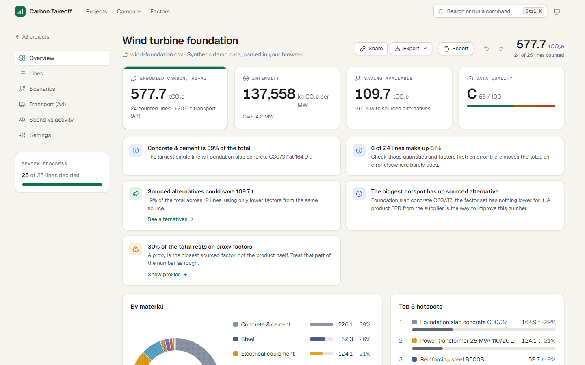

## Why it exists

**Spend-based carbon accounting punishes low-carbon purchases. Activity-based accounting rewards them.**

In the wind demo, buy the two structural steel lines from the electric arc furnace route instead of the blast furnace route, at a 15% price premium. The spend-based estimate for those lines goes **up 15%**, because all it sees is more money. The activity-based estimate goes **down 60%**, because it sees a different product. If your inventory runs on spend data, the better purchase looks like the worse one.

## Quick start

No API key needed.

```bash
npm install
npm run dev
```

Open http://localhost:3000 and pick one of the nine demos, or upload your own CSV or XLSX. Projects are saved in your browser.

| | |
| --- | --- |
| 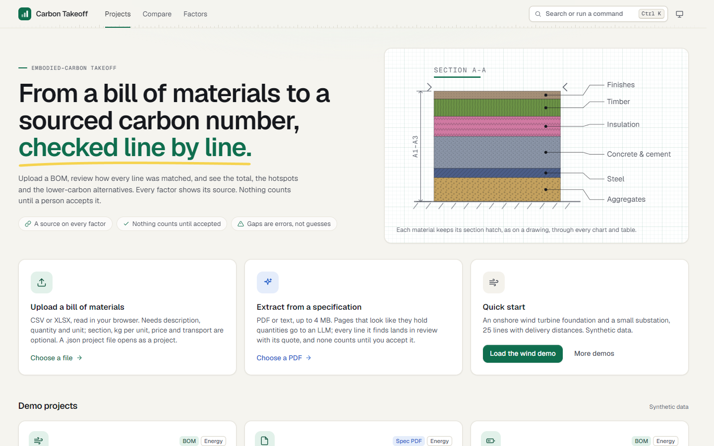 | 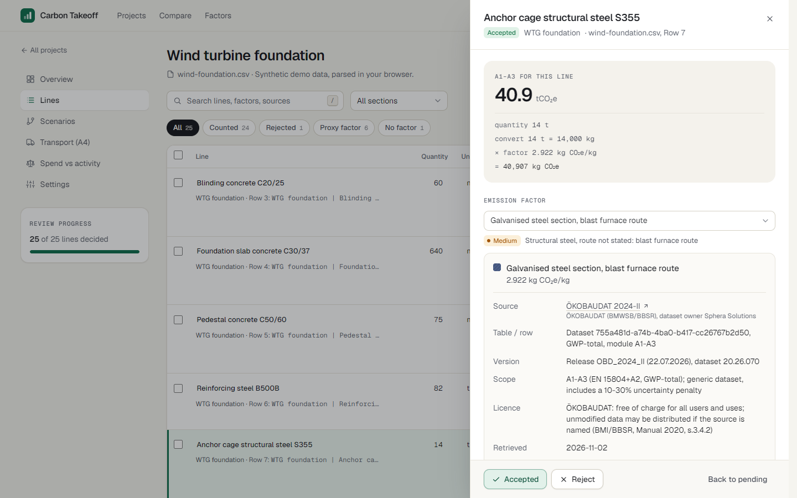 |
| **Start** from a BOM, a specification, a project file or one of nine demos | **Review** every line, with the working and the factor's source a click away |
| 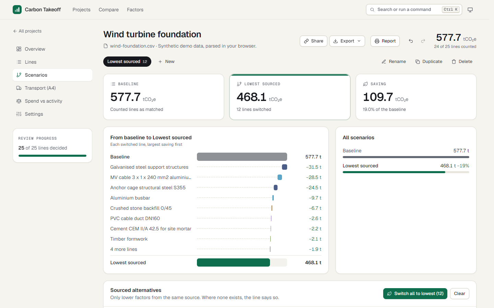 | 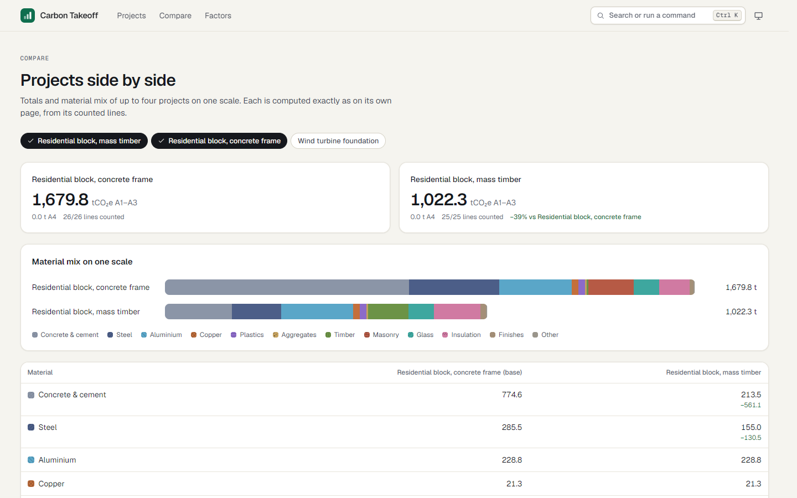 |
| **Scenarios** switch lines to sourced lower-carbon factors | **Compare** up to four projects on one scale |

## What it does

- **Import** CSV or XLSX in the browser, with a column-mapping step for unfamiliar headers; or extract quantities from a PDF or text specification with an LLM. Nothing extracted counts until a person accepts it, and every extracted line carries the quote it came from, checked against its page.
- **Review** with search, filters, a section filter, bulk actions and keyboard shortcuts. Every factor can be overridden, every line edited, every change undone.
- **Overview**: the total, intensity per functional unit (m² GIA, MW, km...), a data-quality grade, a carbon budget, plain-language insights, breakdowns by material and by BOM section, a section-to-material flow and a treemap of every counted line.
- **Scenarios**: named sets of switches to lower factors from the same source, with a waterfall from the baseline. Where no sourced alternative exists, the line says so.
- **Transport (A4)** from each line's mass, mode and distance, with DESNZ freight factors.
- **Spend vs activity**: the same purchase counted both ways, with an adjustable premium.
- **Compare** projects side by side, **report** to print or save as PDF, **export** CSV or a project file, **share** a link that carries the whole project in its fragment.
- **Factor library**: every factor with its source, table and row, version, licence, retrieval date and alternatives.
- Command palette (`Ctrl/Cmd K`), light and dark themes, phone layouts.

| | | |
| --- | --- | --- |
| 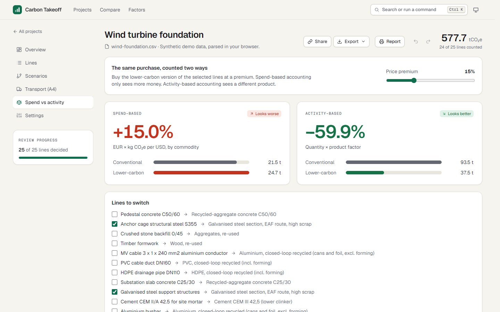 | 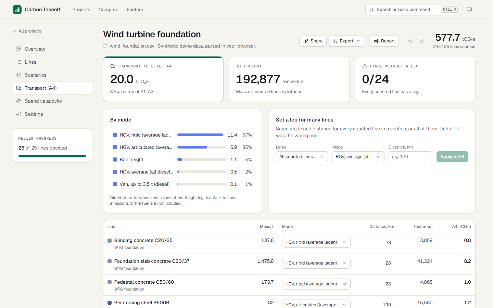 | 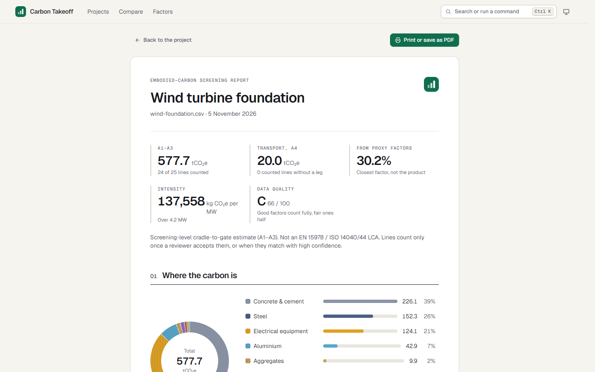 |
| 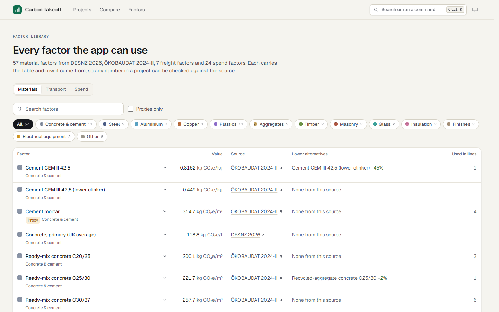 | 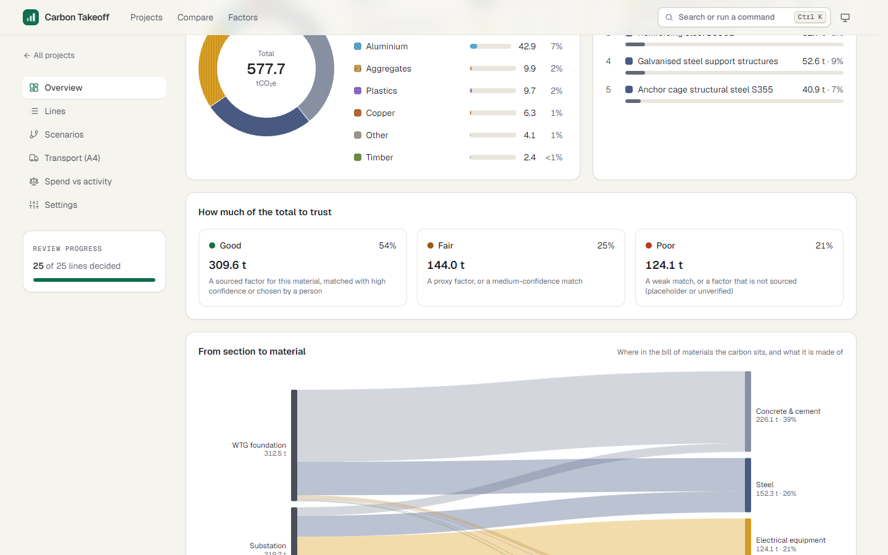 | 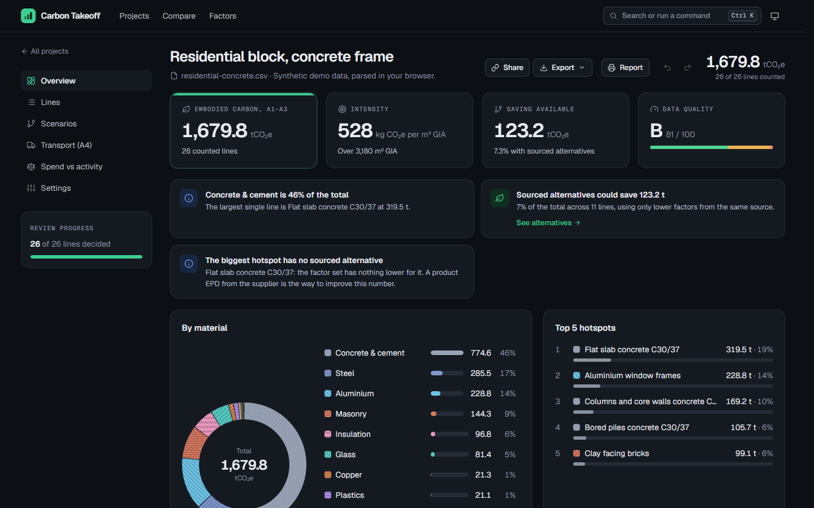 |

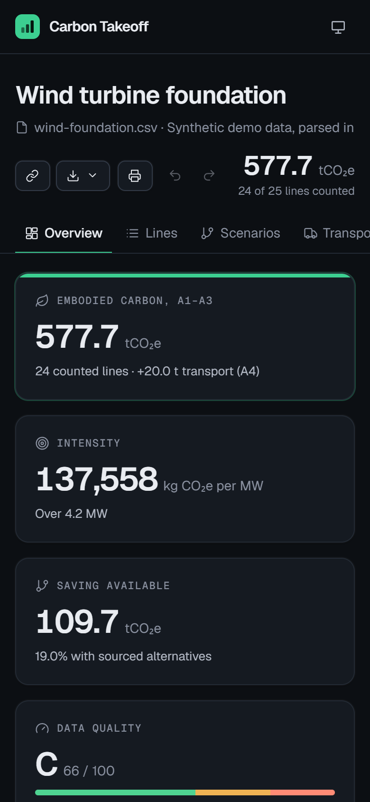 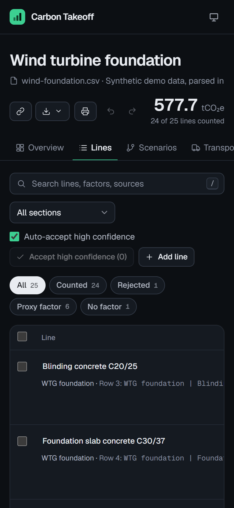

### Demos

| Demo | What it shows |
| --- | --- |
| Wind turbine foundation | A BOM with sections, prices and delivery legs |
| Wind balance-of-plant specification | A 6-page PDF read by extraction (cached, works without a key) |
| Battery storage, 20 MW / 40 MWh | A total dominated by proxies, and graded accordingly |
| Solar park, 12 MWp | PV modules have no sourced factor and stay out of the total |
| Residential block, concrete frame | Strength classes, masonry, envelope, a class rounded up |
| Residential block, mass timber | The same block in glulam and CLT, to compare with the concrete one |
| Logistics warehouse, 12,000 m² | Steel portal frame, where the EAF route makes the biggest difference |
| Rural road reconstruction | Asphalt, recycled and re-used material |
| Water main renewal specification | A plain-text spec, a disagreement between the model and the rules, an item with no quantity |

### Keyboard

| Key | Does |
| --- | --- |
| `Ctrl/Cmd K` | Command palette |
| `1` – `6` | Jump between a project's views |
| `Ctrl/Cmd Z`, `Ctrl/Cmd Shift Z` | Undo, redo |
| `J` / `K` | Lines: next, previous |
| `A` / `R` / `U` | Lines: accept, reject, undecide |
| `X`, `Enter`, `/` | Lines: select, open details, search |

## Live extraction

1. Copy `.env.example` to `.env.local`.
2. Set `ANTHROPIC_API_KEY`. `LLM_MODEL` is optional and defaults to `claude-haiku-5-5`.
3. Upload a PDF or text file on the home page (4 MB, 5 extractions a minute).

Pages are scored for material quantities and only the likely ones are sent. The model makes one strict tool call whose factor ids are limited to the catalogue. Live extraction has only been tested against a fake client so far; see [docs/STATUS.md](docs/STATUS.md).

## How the numbers stay honest

- **No typed-in factors.** `scripts/build_factors.py` reads every value from the published file or API and stops if a label, unit or licence field has changed.
- **Full provenance on every factor**, visible in the line drawer, the factor library and the report.
- **Sources:** UK DESNZ 2026 conversion factors (OGL v3.0), ÖKOBAUDAT generic datasets, US EPA supply chain factors v1.3 (public domain), ECB exchange rate.
- **Alternatives only from the same source, in the same unit, and lower.** C30/37 concrete and rebar have none, and the app says so.
- **Gaps stay gaps.** A line with no factor, no density or no mass is an error, never a zero.

## Limits

This is a screening tool. It mixes sources with different system boundaries, ÖKOBAUDAT generic values include a 10–30% uncertainty penalty, proxies carry a large share of some totals, and A4 covers one tank-to-wheel leg. Read [docs/METHOD.md](docs/METHOD.md) before quoting a number.

## Project structure

```
app/              Routes: home, project views, report, compare, factors, share, /api/extract
components/       UI: project views, charts, command palette, shared primitives
lib/engine/       Matching, units, totals, scenarios, spend, transport, quality, insights (pure, tested)
lib/bom/          CSV and XLSX parsing, column mapping
lib/extract/      PDF and text pages, page selection, extracted lines
lib/llm/          LLM adapter (Anthropic)
lib/charts/       Treemap and sankey layouts
data/             Factors written by scripts/build_factors.py
demo/             Hand extractions and cached demo specifications
public/demo/      Demo BOMs and specifications
scripts/          Factor build, demo PDF and demo cache
docs/             Method, decisions, status, screenshots
```

## Commands

| Command | Does |
| --- | --- |
| `npm run dev` | Development server |
| `npm test` | Engine, parsing, extraction, adapter and chart tests |
| `npm run lint` | Lint |
| `npm run build` | Production build |
| `npm run factors` | Rebuild `data/*.json` from the sources (Python, needs `openpyxl`) |
| `npm run demo:pdf` | Regenerate the demo specification PDF |
| `npm run demo:cache` | Rebuild the demo caches and check every quote |

## Tech

Next.js (App Router), React, TypeScript, Tailwind CSS and Vitest. Hand-drawn SVG charts. unpdf for PDF text, Papa Parse and read-excel-file for tables, the Anthropic SDK for extraction.

## Docs

- [docs/METHOD.md](docs/METHOD.md): boundaries, conversions, matching, A4, quality grade, factors and limitations
- [docs/DECISIONS.md](docs/DECISIONS.md): the design decisions and why
- [docs/STATUS.md](docs/STATUS.md): what works, what's verified and how, reference figures, what's next

## Copyright

© 2026 Jason Faeq. All rights reserved.

The emission factor data keeps its own licences: DESNZ under the Open Government Licence v3.0, ÖKOBAUDAT free of charge with attribution, EPA in the public domain. See [docs/METHOD.md](docs/METHOD.md).
